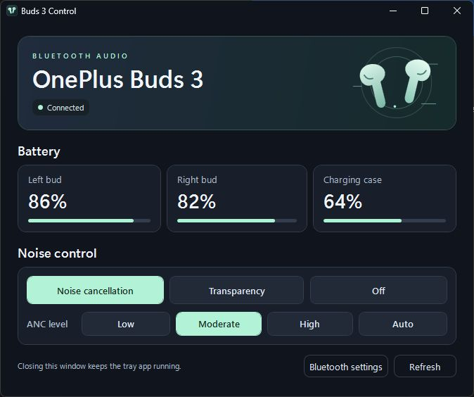
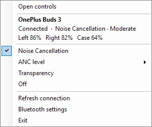

<p align="center">
  
</p>

<h1 align="center">Buds 3 Control</h1>

A Windows 11 app for **OnePlus Buds 3** with a control panel and taskbar shortcuts. Switch between **Noise Cancellation**, **Transparency**, and **Off** over Bluetooth.

## Choose a build

Get the installer or portable executable from the [latest Windows release](https://github.com/thousandecibels/oneplus-buds-3-control/releases/latest).

- **Installer** · Run `Buds3Control-Setup.exe` for a per-user install and a Start menu shortcut. Windows lists **Buds 3 Control** under **Settings → Apps → Installed apps** for uninstalling.
- **Portable** · Run `Buds3Control.exe` from any folder. It contains the same app as the installer.

Use **Exit** in the tray menu to close a running copy before installing, updating, or uninstalling.

## Screenshots

The screenshots show example battery readings with Moderate noise cancellation selected.

### Windows control panel



### Tray quick controls



## Run

1. Pair the earbuds in **Settings → Bluetooth & devices**. Leave them awake and put at least one in your ear to change modes.
2. Open **Buds 3 Control** from Start or double-click the portable `Buds3Control.exe`. Windows may place the mint earbuds icon under the taskbar’s **Show hidden icons** arrow.
3. Choose a noise mode or ANC level in the panel. Closing the panel leaves the app in the tray. Click the tray icon to reopen it, or right-click for quick controls and **Exit**.

Open **ANC level** and choose **Low**, **Moderate**, **High**, or **Auto**. Choosing a level turns on Noise Cancellation. The **Noise Cancellation** shortcut uses the earbuds' last ANC level. Auto adjusts the strength to your surroundings.

The panel and tray menu show the battery percentage for the left bud, right bud, and case. A dash means the earbuds did not report a reading for that part. Open the case lid to see its level when available. Readings refresh about every 10 seconds, or immediately with **Refresh**.

The app reconnects when the earbuds wake up. If it stays disconnected, open the menu and choose **Connection details**. If another earbud control app is connected, close it and choose **Refresh connection**. The app looks for the Bluetooth name `OnePlus Buds 3` and checks the model ID before enabling writes.

## Build from source

Run from this folder in PowerShell. The build uses the .NET Framework compiler included with Windows 11 and produces `dist\Buds3Control.exe`.

```powershell
powershell.exe -NoProfile -ExecutionPolicy Bypass -File .\build.ps1
```

To build both distribution files into `dist\release`, install Inno Setup 7 and run the packaging script. [Inno Setup downloads](https://jrsoftware.org/isdl.php)

```powershell
powershell.exe -NoProfile -ExecutionPolicy Bypass -File .\package.ps1
```

Use `-InnoSetupCompiler 'C:\path\to\ISCC.exe'` for a custom compiler location. Set `-Version` to label a new installer version.

## Diagnostics

Exit the tray app first. The same executable accepts `--status` or `--set off|anc|transparency`. Use `Start-Process -Wait` with redirected standard output and standard error to capture results from the Windows executable.

## Protocol references

- The [QuickBuds protocol notes](https://github.com/spizganed/QuickBuds/blob/main/docs/PROTOCOL.md) document the RFCOMM service and noise control commands.
- The [QuickBuds model list](https://github.com/spizganed/QuickBuds/blob/main/app/src/main/assets/models.json) identifies the Buds 3 as `063C14` and provides its mode mapping.
- [Microsoft's Bluetooth Winsock documentation](https://learn.microsoft.com/en-us/windows/win32/bluetooth/bluetooth-and-connect) describes connecting by service UUID.
